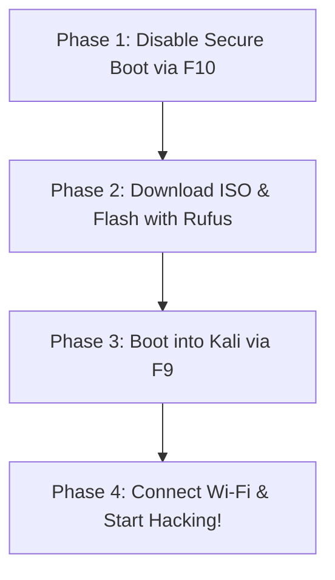

# 🛡️ HP Victus: Complete Kali Live USB Survival Guide
*Keep this guide open on your phone or in your browser so you have it even when Windows is offline!*

---

## 🛑 The "Golden Safety Rule" (Your Universal Panic Button)

If at **ANY** point during BIOS, boot menus, or inside Kali you feel stuck, confused, or worried:

> **The Universal Emergency Exit:**
> 1. **Unplug the USB pendrive.**
> 2. **Hold your laptop's Power Button down for 6 seconds** until the screen goes completely black.
> 3. Press the Power Button once to turn it back on.
> 
> Because the pendrive is unplugged, your HP Victus has only one thing it can possibly start: **your normal Windows desktop**, completely untouched and unharmed.

---

## 📋 The 4-Phase Setup Plan



---

## Phase 1: Disable Secure Boot (Inside HP BIOS)

### Step 1.1: Enter BIOS
1. Shut down your laptop completely (Start Menu → Shut down).
2. Press the **Power Button** to turn it on, and **immediately tap `F10` repeatedly** (twice per second) until the BIOS Setup screen appears.

### Step 1.2: Disable Secure Boot
1. Use the **Right Arrow `→`** key to navigate to the **Boot Options** tab (or **Configuration** / **Security** tab depending on BIOS version).
2. Use the **Down Arrow `↓`** key to highlight **Secure Boot**.
3. Press **Enter**, select **Disabled**, and press **Enter**.

### Step 1.3: Save & Confirm HP Security Code
1. Press **`F10`** on your keyboard (Save and Exit).
2. Select **Yes** and hit **Enter**.
3. **The HP Code Screen:** When the laptop reboots, you will see a screen showing a 4-digit code (e.g. `4821`).
4. Type those 4 numbers on your keyboard and press **Enter**.
5. The laptop will now boot back into your normal Windows desktop!

> 🚨 **What if something goes wrong in Phase 1?**
> * *Didn't see BIOS and Windows booted?* You didn't tap `F10` fast enough. Just restart and tap `F10` right after pressing the power button.
> * *Pressed wrong setting in BIOS?* Press the **`Esc`** key on your keyboard, choose *"Exit Discarding Changes"*, and hit Enter. Nothing will be changed.

---

## Phase 2: Flashing Kali to USB with Rufus (Inside Windows)

### Step 2.1: Plug in Pendrive
1. Plug your USB pendrive (8 GB or larger) into your HP Victus.
2. *Reminder: All existing files on this pendrive will be erased.*

### Step 2.2: Open Rufus
1. Open **Rufus** (we will download it together).
2. **Device:** Ensure your USB pendrive is selected (check the size, e.g., 16 GB or 32 GB).
3. **Boot selection:** Click **SELECT** and choose `kali-linux-2026.3-live-amd64.iso`.
4. **Persistent partition size slider:**
   * Slide it to **4 GB – 8 GB** (or leave default if you just want to test).
   * *This allows your Wi-Fi captures and notes to be saved on the USB across reboots.*
5. **Partition scheme:** Leave as **GPT** (Target system: **UEFI**).
6. Click **START** at the bottom.
7. If Rufus asks: *"Write in ISO Image mode or DD Image mode?"* — Leave the recommended **ISO Image mode** selected and click **OK**.
8. Click **OK** on the warning that data will be destroyed.
9. Wait 3–5 minutes until the status bar says **READY**.

> 🚨 **What if something goes wrong in Phase 2?**
> * *Rufus gives an error?* Unplug the USB, plug it back in, and click START again.
> * *Can this affect Windows `C:` or `D:` drive?* **No.** Rufus has built-in safety protection that automatically hides your internal Windows hard drives so you cannot accidentally select them.

---

## Phase 3: The Big Moment — Booting into Kali Live

### Step 3.1: Restart into the Boot Menu
1. Leave the flashed USB pendrive plugged into your laptop.
2. Click Windows **Start Menu → Restart**.
3. The moment your screen goes black, **immediately start tapping `F9` repeatedly** (twice per second).

### Step 3.2: Select USB Drive
1. A blue/black box titled **Boot Option Menu** will appear:
   ```text
   Boot Option Menu
   > OS boot Manager (UEFI) - Windows Boot Manager
   > USB Hard Drive (UEFI) - [Your USB Pendrive]
   ```
2. Use the **Down Arrow `↓`** to highlight your **USB Hard Drive**.
3. Press **Enter**.

### Step 3.3: Select Kali Live System
1. The Kali Linux boot screen will appear with a dragon logo:
   ```text
   Kali Linux Live Boot Menu
   > Live system (amd64)
     Live system with USB persistence
     ...
   ```
2. Highlight **`Live system with USB persistence`** (or just `Live system (amd64)`).
3. Press **Enter**.
4. In 15–20 seconds, the full **graphical Kali Linux desktop** will load!

> 🚨 **What if something goes wrong in Phase 3?**
> * *Screen shows "Selected boot image did not authenticate"?* Secure Boot is still on. Go back to Phase 1 and make sure Secure Boot is Disabled.
> * *Screen stays black or freezes?* Use the **Universal Emergency Exit**: Hold the Power Button for 6 seconds to shut off, unplug USB, and power back on into Windows.

---

## Phase 4: Inside Kali — Connecting to Wi-Fi & Testing

### Step 4.1: Connect to Wi-Fi
1. Look at the top-right corner of the Kali desktop.
2. Click the **Wi-Fi / Network icon**.
3. Click your home Wi-Fi name, enter your Wi-Fi password, and click **Connect**.
4. You are online!

### Step 4.2: Open Terminal and Verify Internal Wi-Fi Card
1. Click the black terminal icon **`>_`** in the top panel (or press `Ctrl + Alt + T`).
2. Run this command to see your internal laptop Wi-Fi adapter:
   ```bash
   iwconfig
   ```
   *You will see **`wlan0`** listed! (Unlike VirtualBox which showed `eth0`).*

### Step 4.3: How to Turn Off and Return to Windows Cleanly
When you are done:
1. Click the Power icon in the top-right corner → **Shut Down** (or type `sudo poweroff` in terminal).
2. Unplug the USB pendrive.
3. Turn on your laptop — **Windows loads up immediately as if nothing ever happened!**
